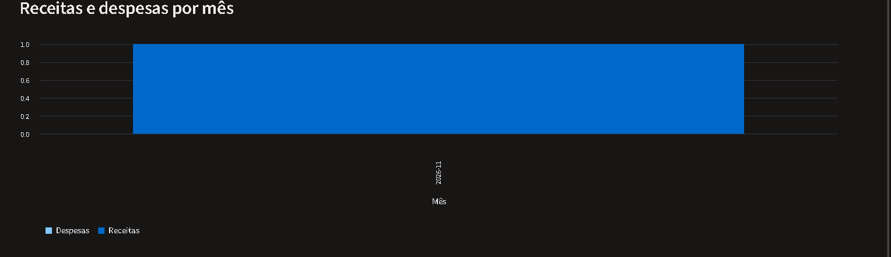
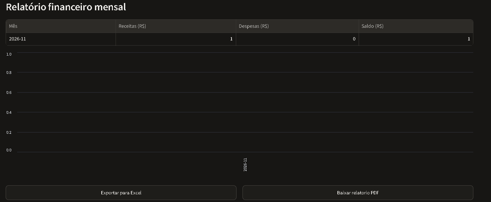

# Controle financeiro

Aplicação local de controle financeiro feita em Python, Streamlit e SQLite. Permite registrar receitas e despesas, acompanhar metas e exportar relatórios por período, categoria e tipo.

## Visão geral

A tela principal reúne os indicadores do período, a tabela de transações e o gráfico mensal. A seção de relatórios apresenta o resumo mensal e os botões para baixar os arquivos Excel e PDF.

## Capturas de tela

### 1. Dashboard

Visão geral com indicadores financeiros, filtros e gráfico mensal.


### 2. Transações

Cadastro de receitas e despesas na barra lateral e tabela de lançamentos.


### 3. Metas

Acompanhamento dos objetivos financeiros.


### 4. Relatórios

Gráfico de receitas e despesas, resumo mensal e saldo.





### 5. Exportação

Os botões permitem baixar os relatórios em Excel e PDF.


## Recursos

- Conta de usuário com senha armazenada em hash PBKDF2-SHA256.
- Cadastro, edição e exclusão de transações e metas.
- Filtros de tipo, categoria e intervalo de datas no dashboard, tabela e relatórios Excel/PDF.
- Banco SQLite e consultas de transações e metas limitadas ao usuário autenticado.
- Exportação Excel e PDF gerada em memória.

## Executar localmente

Requer Python compatível com as dependências listadas em `requirements.txt`.

```powershell
py -m pip install -r requirements.txt
py -m streamlit run app.py
```

Também é possível abrir `iniciar_sistema.bat` no Windows.

## Demonstração com dados fictícios

1. Execute `py demo.py` ou abra `iniciar_demo.bat`.
2. Aguarde o navegador abrir em `http://localhost:8766`.
3. Entre com usuário `demo` e senha `DemoFinanceiro2026!`.
4. Experimente os filtros, cadastre uma transação ou meta e baixe o Excel/PDF.
5. Feche a janela do terminal para encerrar a demonstração.

A demonstração usa `financeiro_demo.db`, separada do banco local normal. As credenciais são públicas e os dados são fictícios: use apenas para demonstração local. Não publique essa configuração como serviço compartilhado nem use dados reais; isso requer configuração de implantação, credenciais e armazenamento apropriados.

## Executável Windows da demonstração

Em Windows 64 bits, execute `build_demo_exe.bat`. O arquivo será criado em `dist/FinanceiroDemo.exe`; os dados ficam em `%LOCALAPPDATA%\FinanceiroDemo\financeiro_demo.db`. Mantenha o terminal aberto enquanto usa o programa e feche-o para encerrar.

## Estrutura

- `app.py`: interface Streamlit.
- `auth.py`: cadastro e autenticação.
- `services.py`: operações financeiras e consultas com escopo por usuário.
- `relatorios.py`: relatório mensal e exportações.
- `metas.py`: metas e aportes.
- `database.py`: esquema e migrações SQLite.
- `demo.py`: preparação dos dados fictícios e inicialização local.

## Testes

Para executar os testes automatizados:

```powershell
py -m pytest test_calculos_basicos.py test_services.py
```

Os testes usam bancos temporários e não alteram `financeiro.db`.

