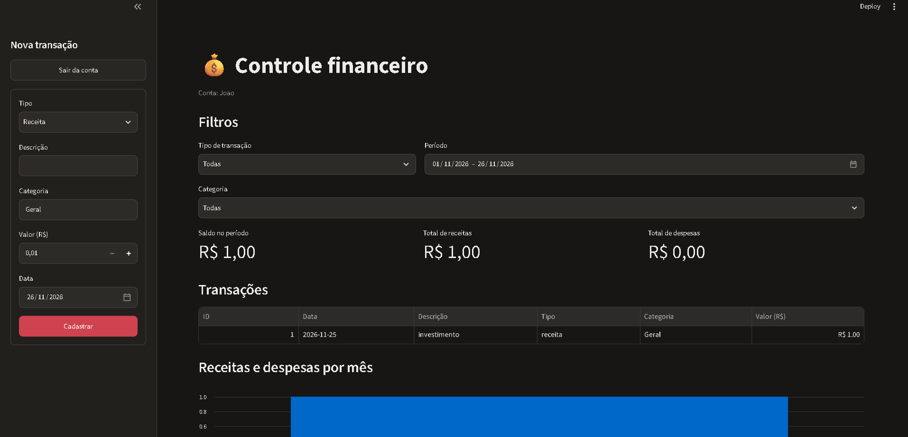
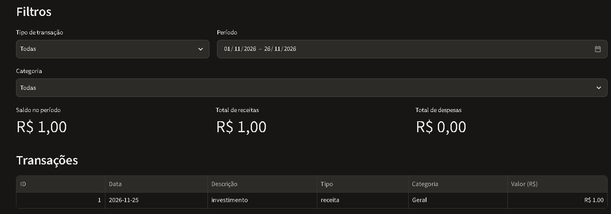
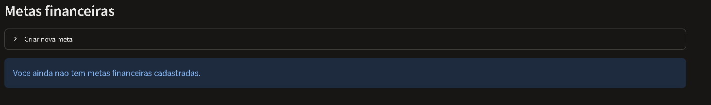
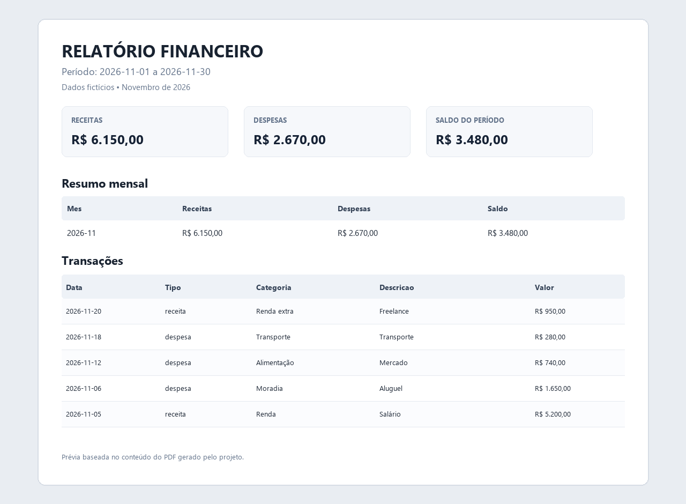
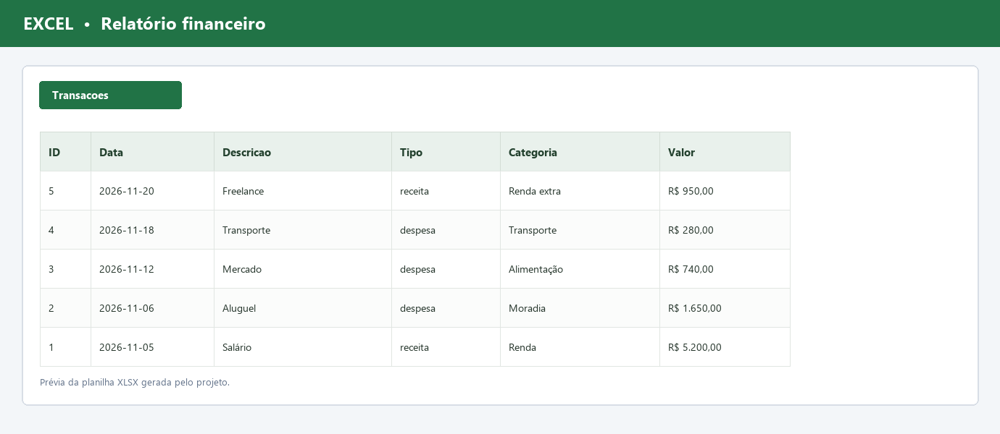

# Controle Financeiro Pessoal

Aplicação web local para organizar receitas, despesas e objetivos financeiros. O projeto reúne um dashboard interativo, cadastro de transações, filtros e relatórios exportáveis em uma interface feita com Python e Streamlit.

> **Status:** projeto demonstrativo para execução local, com dados fictícios. Não use a configuração de demonstração como serviço compartilhado nem insira dados financeiros reais.

## Funcionalidades

- Dashboard com saldo, receitas e despesas do período.
- Cadastro, edição e exclusão de receitas e despesas, com categoria e data.
- Filtros por tipo de transação, categoria e intervalo de datas.
- Gráfico mensal de receitas e despesas.
- Metas financeiras com prazo, aportes e acompanhamento do progresso.
- Relatórios mensais e exportação para Excel (`.xlsx`) e PDF.
- Autenticação de usuários e consultas de transações e metas vinculadas à conta.

## Tecnologias

- **Python** — lógica da aplicação e serviços financeiros.
- **Streamlit** — interface web interativa.
- **SQLite** — armazenamento local dos dados.
- **Pandas** — preparação dos dados para visualizações.
- **PBKDF2-SHA256** — hash de senhas.
- **Biblioteca padrão do Python** — geração dos arquivos Excel e PDF.

## Capturas de tela

### Dashboard

Visão geral com indicadores, filtros, transações e visualização mensal.



### Transações

Cadastro de receitas e despesas e listagem dos lançamentos.



### Metas financeiras

Acompanhamento dos objetivos e valores economizados.



### Relatórios

Gráfico mensal e resumo de receitas, despesas e saldo.


### Exportação para Excel e PDF

Os exemplos abaixo foram gerados pelos exportadores do projeto usando dados totalmente fictícios. As prévias mostram o conteúdo dos arquivos reais disponíveis para download.

#### Prévia do PDF



[Baixar exemplo em PDF](docs/exemplos/relatorio-exemplo.pdf)

#### Prévia do Excel



[Baixar exemplo em Excel](docs/exemplos/relatorio-exemplo.xlsx)

## Executar localmente

Requisitos: Windows com Python instalado e o comando `py` disponível.

Na pasta do projeto, instale as dependências e inicie a aplicação:

```powershell
py -m pip install -r requirements.txt
py -m streamlit run app.py
```

Acesse `http://localhost:8501`. Também é possível iniciar a versão local com duplo clique em `iniciar_sistema.bat`.

## Testar a demonstração fictícia

A demonstração usa um banco SQLite separado (`financeiro_demo.db`) e uma conta de exemplo. Para executá-la:

1. Instale as dependências com `py -m pip install -r requirements.txt`.
2. Execute `py demo.py` ou abra `iniciar_demo.bat`.
3. Acesse `http://localhost:8766`.
4. Entre com **usuário:** `demo` e **senha:** `DemoFinanceiro2026!`.
5. Teste os filtros, cadastre dados fictícios e experimente as exportações.
6. Volte ao terminal e pressione `Ctrl+C` para encerrar.

A conta e a senha são públicas e o banco da demo pode ser alterado durante o uso. Essa configuração serve somente para uma demonstração local. Não a disponibilize como serviço compartilhado nem use dados reais. Uma implantação para clientes exige revisão de segurança, configuração de credenciais e armazenamento apropriados, além de validação no ambiente de destino.

## Executável Windows

Para criar um executável local de demonstração em Windows 64 bits, execute `build_demo_exe.bat`. O arquivo é gerado em `dist/FinanceiroDemo.exe`; os dados da demonstração ficam em `%LOCALAPPDATA%\FinanceiroDemo\financeiro_demo.db`.

## Estrutura do projeto

| Arquivo | Responsabilidade |
| --- | --- |
| `app.py` | Interface Streamlit e fluxo principal da aplicação |
| `auth.py` | Cadastro, autenticação e hash de senhas |
| `services.py` | Operações e consultas financeiras |
| `relatorios.py` | Relatórios e exportações Excel/PDF |
| `metas.py` | Cadastro de metas e registro de aportes |
| `database.py` | Esquema e migrações SQLite |
| `demo.py` | Preparação e inicialização da demonstração fictícia |

## Testes automatizados

Para executar a suíte existente:

```powershell
py -m pytest --basetemp=.pytest-run-temp test_calculos_basicos.py test_services.py
```

Os testes usam bancos temporários.